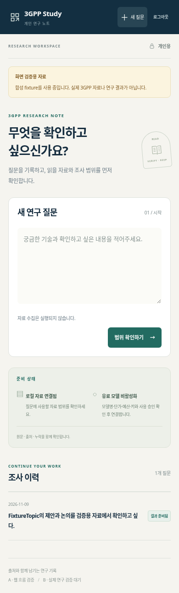
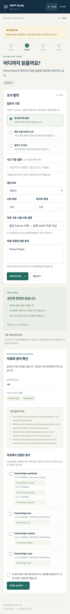
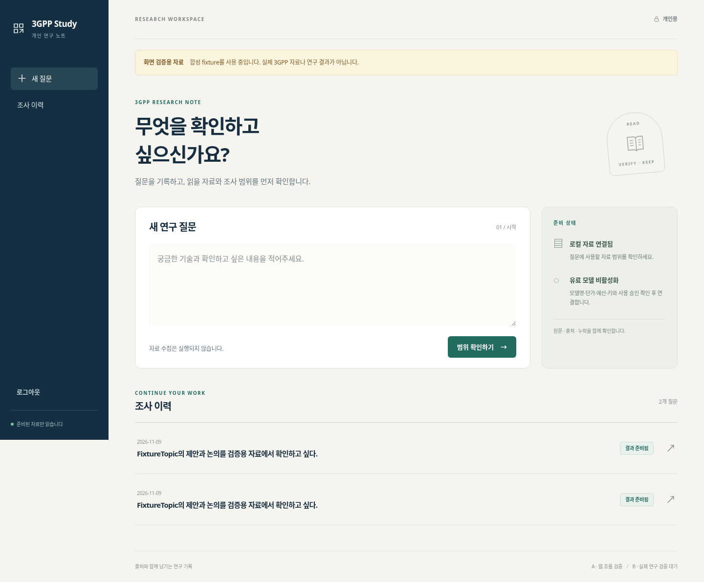
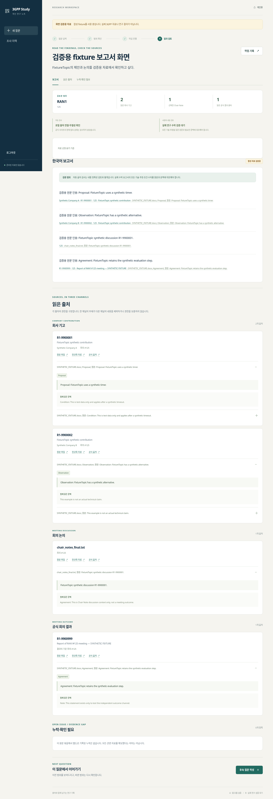

# A 단계 구현 검토 — 2026-11-09 KST

**웹 기능 구현 완료, 실제 연구 검증 대기.**

이 자료는 합성 fixture와 빈 데이터로 검증한 A 단계의 결과입니다. 실제 corpus·모델을
사용한 B 단계 보고서 수락이 아닙니다. main 반영·tag·운영 배포는 진행하지 않았습니다.

| 검사 | 새로 실행한 결과 |
|---|---|
| 기존 core + 신규 Python 검사 | **521 passed**, 38.91초. 기존 396개 + 신규 125개 |
| 외부 소켓 연결 | 차단 상태, 연결 시도 **0건** |
| 모델 테스트 | MockTransport만 사용. 실제 유료 호출 **0건** |
| 3GPP 자료 수집 | **0건**. 새 실제 corpus 생성 없음 |
| Chromium 화면 검사 | 360·390·1440px × 7화면 = **21개 통과** |
| 화면 조건 | 가로 넘침 0, 주요 버튼·입력·펼침 조작 44px 이상, JS/console 오류 0 |
| 브라우저 외부 요청 | 차단 상태, 외부 요청 **0건** |
| 새 경로 복원 | 합성 corpus와 앱 상태를 별도 복원, 원래 경로 제거 후 이력·보고서·출처 열람 성공 |
| core 코드 변경 | `src/threegpp/` 변경 없음 |

테스트 의존성 Starlette/AnyIO 사이의 deprecated alias 경고 1건이 있습니다.
기능 실패는 없으며 이 경고를 숨기지 않았습니다. 원격 CI가 실행됐다고 주장하지 않습니다.
상세 결과는 [JUnit](python-tests.xml), [브라우저 검사 JSON](browser-results.json),
[실행 버전](environment.json)에 보존했습니다.

## 검증한 흐름

질문 입력·범위 확인·원문 용어 후보의 명시적 수락·승인 revision·실행·3채널 출처·
검증용 결과·이력·후속 질문을 검사했습니다. 빈 데이터, 미승인·오래된 승인, 한도 초과,
중복 제출 10회, queued/running/completed 재시작, 잘못된 인용, 출처 변조, 인증·CSRF,
백업 중 실행·경로 이탈·덮어쓰기 거부를 포함합니다. 모델 adapter의 인증 오류·429·
timeout·잘못된 응답·예산 경쟁도 모의 검사했으며 실제 제공자에 요청하지 않았습니다.

독립 검토에서 발견한 재승인 시 이전 작업 재사용, 새 범위 실행 버튼, 이전 결과 접근,
fixture 표식 소실, 일반 Proposal locator, outcome 권한 회의 표시 문제를 수정하고
회귀 검사를 추가했습니다. 이전 결과는 당시 승인 범위로 열리며 나중 작업이 실패해도
이전 성공 결과가 사라지지 않습니다.

모델 입력 계획에는 실제 선택한 구절·문맥을 사용합니다. A의 UTF-8 byte 계획값을
모델별 정확한 token 측정이라고 표현하지 않습니다. 누락·절단은 별도 표시합니다.
자료의 참조 시점은 해당 사본의 기준이며 최신 논의의 완전성을 뜻하지 않습니다.

## 화면 캡처

모든 캡처는 **합성 자료 검증용**입니다. 실제 3GPP 자료·회사 주장·연구 결과가 아닙니다.
외부 미리보기는 제공하지 않았고 QA용 loopback 서버는 종료했습니다.

### 휴대폰 — 질문·이력 (390px)

### 휴대폰 — 범위·원문 용어 확인 (390px)

### 데스크톱 — 질문·이력 (1440px)

### 데스크톱 — 검증용 결과·3채널 출처 (1440px)

## B 단계 대기 항목

- 실제 자료 사본 및 용량·원래 provenance·클라우드 복원 결과.
- canonical `$CODEX_HOME/TECHNICAL_WRITING_STYLE.md` 제공과 확인. 다른 두 보고서 지침과 별개입니다.
- 모델명·현재 단가·예산 집행·모델별 tokenizer·키·명시적 사용 승인 후 비활성 adapter 연결.
- 실제 수락 보고서의 모든 출처 링크 자동 검사와 **모든 기술 주장·조건·수치·권한을 원문·필요 문맥과 대조하는 별도 사람 검토**.

운영 사업자·도메인·정기 백업 일정은 배포 때 정합니다. A 결과 수락이 main 반영이나
운영 배포의 자동 승인을 뜻하지 않습니다.

## 재현·자료 준비

- [수정 계약](../../TASK_CONTRACT_V014.md)
- [실행·검증·앱 상태 복원](../../WEB_APP.md)
- [필요 파일·용량 조사·전달·corpus 복원](../../CORPUS_TRANSFER.md)

Python 검사는 `scripts/check_web_offline.py`, 화면 검사는
`scripts/check_web_browser.py --chromium /usr/bin/chromium --output work/review/browser`를
사용했습니다. 필요한 설치·암호 설정과 전체 명령은 실행 가이드에 있습니다.
